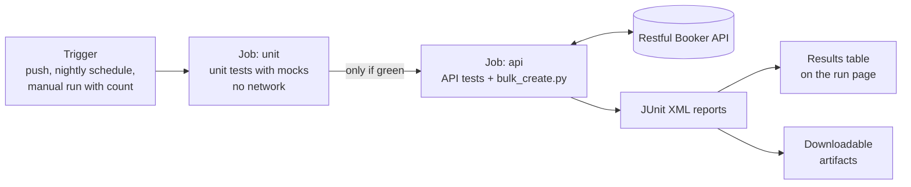
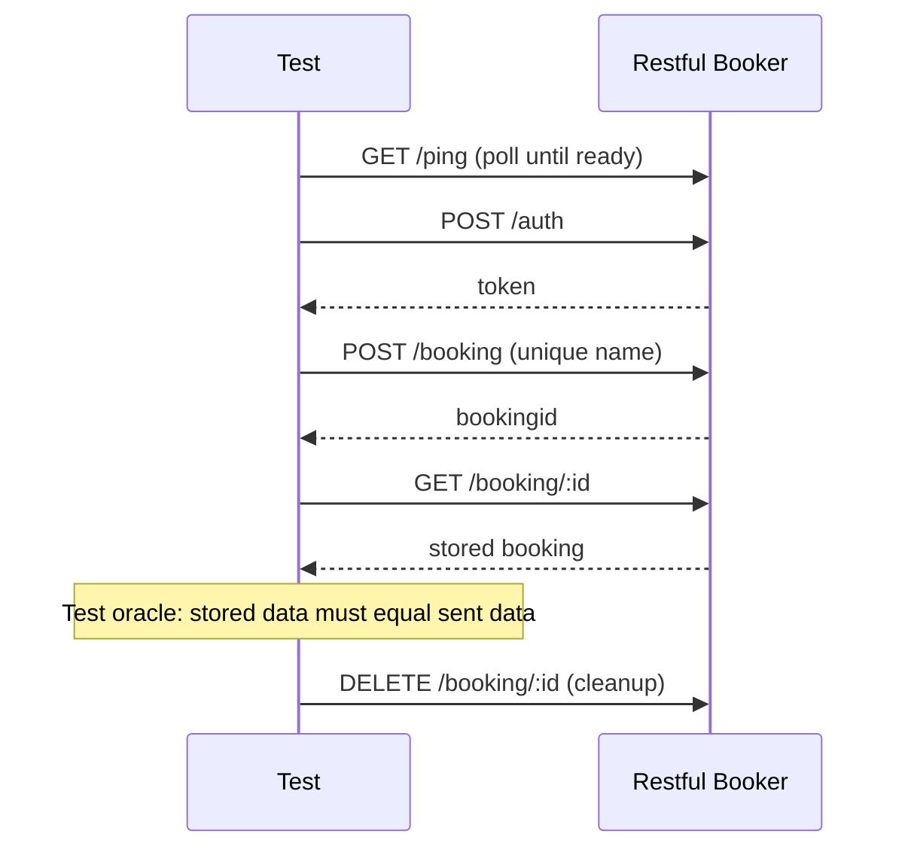
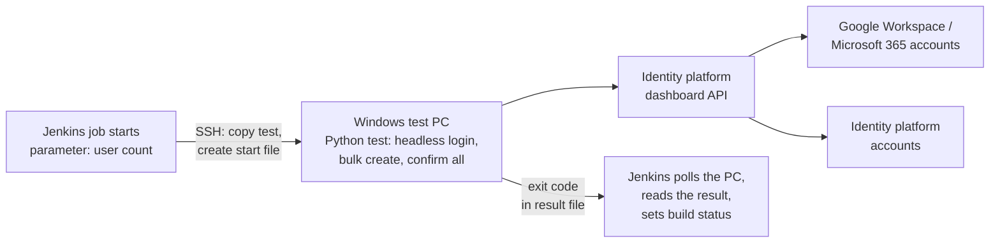

# API provisioning tests

[](https://github.com/fbrabcova/api-provisioning-tests/actions/workflows/tests.yml)

Automated API tests in Python for the public [Restful Booker](https://restful-booker.herokuapp.com/apidoc/index.html) API, run by GitHub Actions on every push, every night and on demand.

The project is a public rebuild of a test I designed at work: a Jenkins job that bulk-provisioned user accounts through an identity platform's REST API into Google Workspace and Microsoft 365, verified them and reported the result back to CI. The original code is private, so this version uses a public practice API. The architecture is the same, and the problems I found when reviewing the original are fixed here.

## How the pipeline works



## What one test does

Every test checks the outcome, not only the status code:



## Background: the original test



The user count was a parameter, so one job served four goals:

| Goal | Test type | How this repository reflects it |
|---|---|---|
| An account is created and linked on both sides | Functional end-to-end test | Every booking is read back and compared with what was sent |
| Many staged accounts can be confirmed at once without errors on either side | Volume test of a bulk operation | `bulk_create.py --count N` verifies every item and fails the run on any error |
| How the platform behaves with hundreds of users at once | Performance / load test | Per-item timing is recorded in the JUnit report. Load is deliberately not run here: a shared public sandbox is not a place for load tests |
| Where the limits of the count parameter are | Boundary value analysis and capacity testing | The count is a CI parameter (manual run), so runs with 0, 1 and growing values can be compared |

## What it shows

| Area | Where |
|---|---|
| REST API testing: GET, POST, PUT, PATCH, DELETE, status codes, query parameters | `tests/api/` |
| A real test oracle: every test checks the stored data, not only the status code | `tests/api/test_booking_crud.py` |
| PUT vs PATCH semantics and negative tests (missing token, incomplete PUT, unknown id) | `tests/api/test_booking_crud.py` |
| Safe retries: idempotent requests are retried with exponential backoff, POST is never duplicated | `booker/client.py` |
| Polling a health endpoint instead of a fixed sleep | `BookerClient.wait_until_ready` |
| Unit tests with mocks, no network (fast, run first) | `tests/unit/` |
| Bulk data provisioning with per-item verification and a JUnit XML report | `bulk_create.py` |
| CI: unit job, then API job (downstream), nightly schedule, manual run with a parameter, artifacts | `.github/workflows/tests.yml` |
| Test results shown on the run page, parsed from JUnit XML | `scripts/junit_summary.py` |
| Correct exit codes, so a failed run can never show green | `bulk_create.py`, pytest |

## Lessons from the original test, applied here

1. **No false negatives.** The original swallowed an error in the final confirmation step and still exited with 0. Here every failure is recorded and changes the exit code.
2. **Check the outcome.** The original only checked that the server answered HTTP 200. Here each booking is read back and compared with what was sent.
3. **Retry only what is safe to repeat.** The original retried the whole create sequence, including a non-idempotent POST, which could create duplicates. Here POST is retried only after checking that the first attempt did not already create the record.
4. **Time units in names.** The original compared a timeout of 60000 (milliseconds) with seconds, so a stuck run waited almost 17 hours. Here every timeout is in seconds and named `*_s`.
5. **Wait for a state, not a time.** Fixed sleeps make tests flaky. Here the client polls `/ping` until the API is ready.
6. **Publish results.** Results are written as JUnit XML, shown as a table on the run page and stored as artifacts.

## Run it locally

```bash
python -m venv .venv
source .venv/bin/activate        # Windows: .venv\Scripts\activate
pip install -r requirements.txt

pytest tests/unit                # unit tests, no network
pytest tests/api                 # API tests against the live service
python bulk_create.py --count 10 # bulk create, verify, report, clean up
```

The public demo credentials (`admin` / `password123`) are used by default. They can be overridden with the `BOOKER_USER`, `BOOKER_PASSWORD` and `BOOKER_URL` environment variables.

## Project structure

```
booker/
  client.py        API client: retries, polling, safe POST
  data.py          unique test data
tests/
  unit/            unit tests with mocks (no network)
  api/             API tests against the live service
scripts/
  junit_summary.py JUnit XML to a results table in GitHub Actions
bulk_create.py     bulk provisioning script with JUnit report
.github/workflows/ CI pipeline
```

## Note

Restful Booker is a shared public sandbox that resets its data regularly, so tests create their own uniquely named bookings and delete them afterwards.
